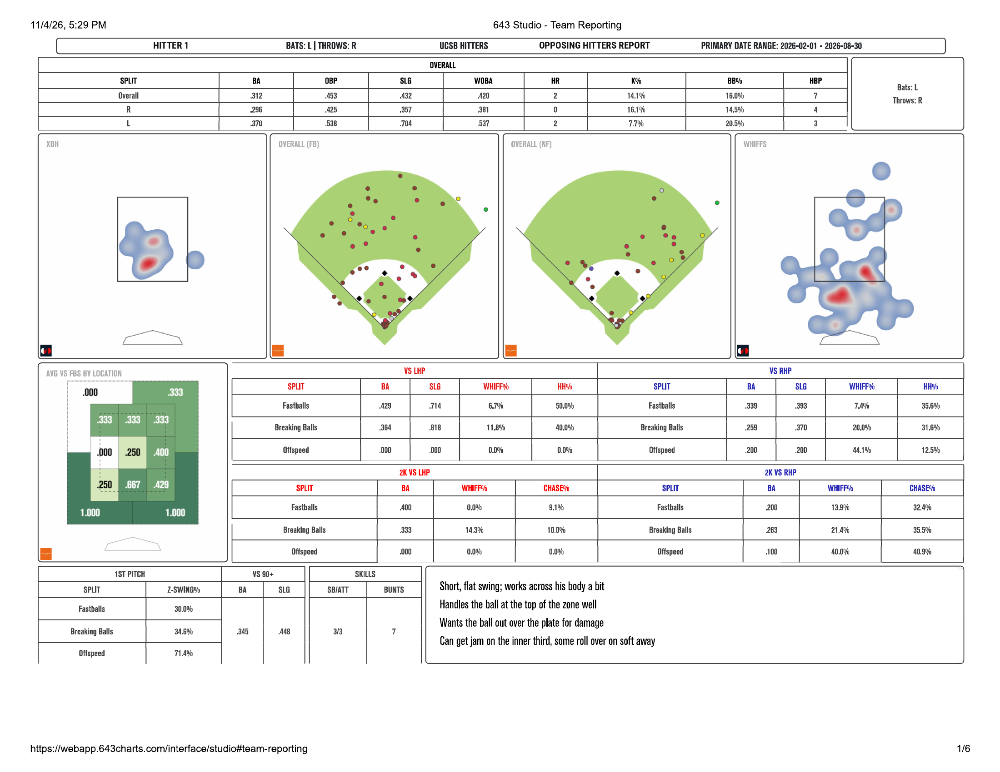
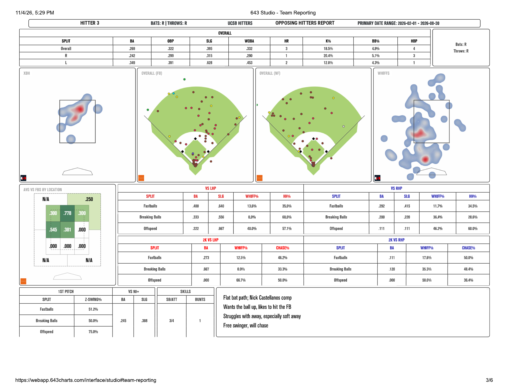

## Overview

Before a series, our staff gets both a full team overview and a one-page report on every hitter we have information on on the opponent's roster. Each report describes the skills and weaknesses of the hitter so our coaching staff can strategize the best pitcher matchup, how to position our defense, and how to attack him. I built the report layout using 643 Charts' team reporting tool, and it populates from the opponent's season of charted data in minutes. I write the scouting notes at the bottom of each page after watching video.

## What's on the page

- **Platoon splits:** BA, OBP, SLG, wOBA, HR, K%, BB% and HBP, overall and by pitcher handedness.
- **Hot & cold zones:** a heat map of XBH, BA vs FBs by location, and a heat map of whiffs; understand where in the zone his swing is most and least effective.
- **Spray charts:** every ball in play plotted on a field diagram, helping the defense position themselves and understand the hitter's bat path.
- **Pitch-type splits:** BA, SLG, whiff rate and hard-hit rate against fastballs, breaking balls, and offspeed pitches from each handedness.
- **Plate approach:** metrics describing 1st pitch and two strike approach, including zone swing rates, chase rates, and outcomes by pitch type.
- **Skills:** results against 90+ mph velocity, stolen bases and bunts.
- **Scouting notes:** my written read on his swing and how to pitch him based on video analysis and performance data.

## Sample output

::: {layout-ncol=2}

:::

[Download the sample reports (PDF)](../reports/Sample_Opposing_Hitters_Report.pdf). Player names and photos have been removed.

## Impact

Prior to each series, the coaching staff meets to review all scouting reports and gameplan. Our pitching coach uses these hitter reports to plan his pitch selection against each hitter, our infield and outfield coaches use them to position our defense, and our head coaches uses them to make matchup decisions throughout the series. We quickly review the key points with our pitching staff the night before the series begins, so everyone is aligned on the strategy.
