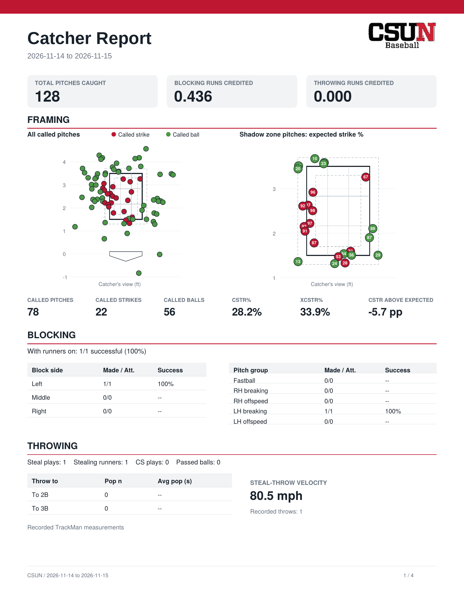

## Overview

These catcher reports are created and sent to our catchers and catching coach after every game. The script combines a TrackMan file with our hand-charted tracking data to produce a PDF with a one-page report for each catcher who appeared. They tell our coach how each catcher performed framing, blocking, and throwing out would-be base stealers. The report uses an expected-strike model and run expectancy based blocking and throwing runs to measure each catcher's impact on the game.


## What's on the page

- **Framing:** a close-up of the strike zone with every called strike and ball in the shadow zone plotted, color coded, and labeled with expected-strike probability. Called strike rate above expected shows the catcher's framing performance compared to the mid-major D1 average.
- **Blocking:** blocks made and attempted with runners on, broken down by side and by pitch group, plus the runs credited for successful blocks.
- **Throwing:** steal attempts, caught stealings, throw velocity, pop times to each base, and runs credited for caught stealings.

## Sample output

::: {layout-ncol=1}

:::

[Download the sample report (PDF)](../reports/Sample_Catcher_Reports.pdf). Player names have been removed.

## The expected-strike model

To judge framing you need to know how often a pitch in a given spot *should* be called a strike. The report uses a location-only model; a smoothed grid of called-strike probability every 0.05 ft across the zone, trained on **over 90,000 called pitches from 741 games**. On a holdout set of 15,546 pitches it predicted a 33.0% strike rate against an actual 32.5% (Brier score: 0.066).

A catcher's CStr% minus his xCStr% on a subset of pitches shows whether he's getting more or less called strikes than the locations deserve. The model doesn't account for the umpire or the batter's height.

## Turning blocks and throws into runs

Blocking and throwing runs created are calculated using Fangraphs' Run Expectancy (RE) tables. **A successful block** is credited with the difference between the actual situation and the one where every runner moves up a base. **A caught stealing** is credited with the difference between the runner being safe at the base he tried for and the situation after the out. **Failed blocks and successful steals** count as zero, so these are totals of credit earned, not net runs saved.


## Impact

These reports are produced postgame and sent to our catchers and catching coach to look over. If a catcher struggled with his blocks on one side of the plate the previous game, his pre-game drill work the next day might focus on improving that area. If the reports consistently show that a catcher struggles receiving on one side of the plate, we might decide not to catch him when particular pitchers who work to that side often throw. The reports are used to evaluate the performance and guide the development of our catchers.

## What's next

I plan on changing the throwing section of this report to a more actionable visual. I want to show the pitch location of each pop time plotted in the strike zone so that our catching coach gets a better idea of where a catcher's transfer is best or needs improvement.

## Code

The run-value credit for blocks and caught stealings:

<details>
<summary>Show code</summary>

```python
def block_credit(table, bases, outs, success):
    """Credit for a successful block: the run value of every runner NOT moving up one
    base (a runner on third would have scored). Uses only the pre-pitch base/out
    state; count, batter result and advancement odds aren't modeled. A failed block
    is worth zero (we only credit positive plays)."""
    if not success:
        return 0.0
    if not any(bases):
        raise ValueError("A block with empty bases is outside the tracked population")
    everyone_advances = (0, bases[0], bases[1])
    raw = bases[2] + expectancy(table, everyone_advances, outs) - expectancy(table, bases, outs)
    return max(0.0, raw)


def throwing_credit(table, bases, outs, targets, outcome, advance=False, out_target=None):
    """Credit for a caught stealing: run value if the runner had been safe minus the
    run value after the out. A safe steal is worth zero.
    Returns (credit, bases after, runs scored on the play)."""
    if outcome == "safe":
        after, runs = steal_result(bases, targets, advance)
        return 0.0, after, runs
    if outcome != "out":
        raise ValueError("Steal outcome must be safe or out")
    if advance:
        raise ValueError("Caught stealing plus advance on throw needs individual runner outcomes")
    if len(targets) > 1 and out_target not in targets:
        raise ValueError("A double steal with an out needs OutBase (2 or 3)")

    out_target = out_target or targets[0]
    if_safe, safe_runs = steal_result(bases, targets)
    actual, actual_runs = steal_result(bases, targets, out_target=out_target)
    credit = (safe_runs + expectancy(table, if_safe, outs)) - (actual_runs + expectancy(table, actual, outs + 1))
    return max(0.0, credit), actual, actual_runs
```

</details>

[View the full code on GitHub](https://github.com/williamjmedina9/catcher-reports)
