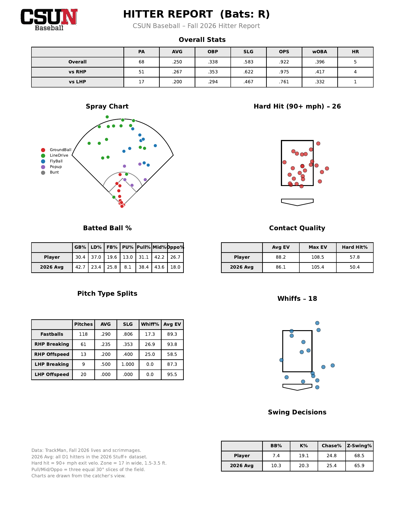

## Overview

These hitter reports were sent to our hitting coaches at the conclusion of the fall and will be updated and sent to them periodically throughout the season. The script uses a combined TrackMan file to produce one PDF document where each hitter gets his own one-page report. They tell our coaches about our hitters' platoon and pitch type splits, how hard they're hitting the ball and where, pitch locations they're excelling against and struggling with, and what their swing decisions have been like. Every rate is shown next to the mid-major D1 average for context.


## What's on the page

- **Overall Stats:** PA, AVG, OBP, SLG, OPS, wOBA and HR, overall and by platoon split.
- **Pitch Type Splits:** results against fastballs,breaking balls, and offspeed pitches from each handedness.
- **Hard Hit and Whiffs:** every pitch hit over 90 mph and every pitch swung and missed at plotted in the zone from the hitter's view.
- **Contact Quality:** average exit velocity, max exit velocity and hard-hit rate.
- **Swing Decisions:** walk rate, strikeout rate, chase rate and in-zone swing rate.
- **Spray Chart:** every ball in play on a field diagram, colored by batted-ball type.
- **Batted Ball %:** ground-ball, line-drive, fly-ball, popup, pull, middle and opposite-field rates.


## Sample output

::: {layout-ncol=1}

:::

[Download the sample report (PDF)](../reports/Sample_Hitter_Reports.pdf). Player names have been removed.


## How it works

The script combines multiple TrackMan files and keeps only our hitters. It accounts for potential mis-tagged names with improper spacing, capitalization, or spelling. It also recognizes switch hitters and gives them a separate page for each side of the plate.

A few details:

- **Mid-major averages.** The mid-major averages are calculated using TrackMan data from teams in the Big West, Mountain West, and West Coast conferences.
- **Avg max exit velocity.** Comparing a hitter's max exit velocity to the single hardest-hit ball in a 200,000 pitch file would make everyone look weak. Instead, the benchmark is the average of each D1 hitter's personal max, among hitters with at least 20 balls in play.
- **Spray charts for LHH.** Angles are flipped for left-handed hitters, so "pull" always means pull, and pull, middle and opposite-field rates can be compared across hitters.
- **Accounting for ABs/PAs correctly.** TrackMan records strikeouts, walks, and hit by pitches in the KorBB column while all balls in play are recorded under PlayResult. The script accounts for this and keeps just one result-bearing pitch per plate appearance to ensure rates are calculated correctly.


## Impact

These reports were produced at the end of the fall and were reviewed with each hitter during individual exit meetings with our hitting coaches. Winter development plans were created based on the insights the reports gave. Some hitters had poor spray charts and were given drills to focus on bat path adjustments. Others had high chase rates and were given drills to improve their feel for the zone. They will be updated and produced periodically throughout the year to track the progress and guide the development of our hitters.


## Code

Every stat line on the page comes from one function:

<details>
<summary>Show code</summary>

```python
def stat_line(pas):
    """AVG / OBP / SLG / OPS / wOBA / HR for a set of plate-appearance-ending pitches."""
    result = pas["PlayResult"]
    singles = (result == "Single").sum()
    doubles = (result == "Double").sum()
    triples = (result == "Triple").sum()
    hr = (result == "HomeRun").sum()
    bb = (pas["KorBB"] == "Walk").sum()
    hbp = (pas["PitchCall"] == "HitByPitch").sum()
    sac = (result == "Sacrifice").sum()

    hits = singles + doubles + triples + hr
    at_bats = len(pas) - bb - hbp - sac
    total_bases = singles + 2 * doubles + 3 * triples + 4 * hr
    obp_denominator = at_bats + bb + hbp + sac

    avg = hits / at_bats if at_bats else 0
    slg = total_bases / at_bats if at_bats else 0
    obp = (hits + bb + hbp) / obp_denominator if len(pas) else 0

    w = WOBA_WEIGHTS
    woba_numerator = (w["BB"] * bb + w["HBP"] * hbp + w["1B"] * singles
                      + w["2B"] * doubles + w["3B"] * triples + w["HR"] * hr)
    woba = woba_numerator / obp_denominator if len(pas) else 0

    return {"PA": len(pas), "AVG": round(avg, 3), "OBP": round(obp, 3),
            "SLG": round(slg, 3), "OPS": round(obp + slg, 3),
            "wOBA": round(woba, 3), "HR": hr}
```

</details>

[View the full code on GitHub](https://github.com/williamjmedina9/hitter-reports)
