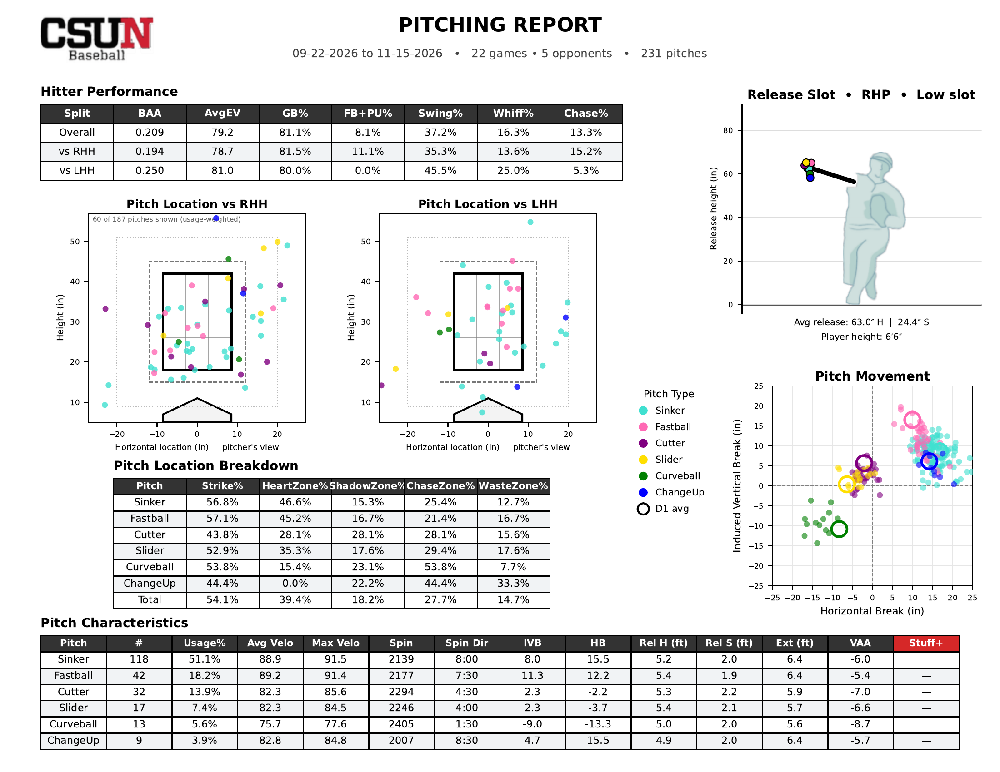
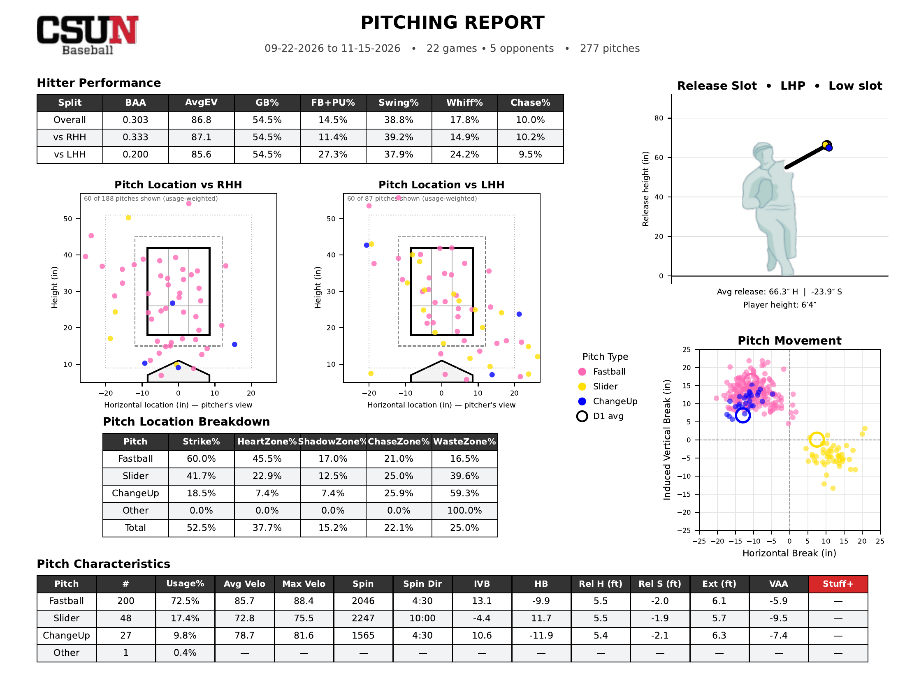

## Overview

These internal pitcher reports are created and sent to our pitching coaches after every game. The script uses a TrackMan file to produce one PDF where each pitcher who appeared gets his own one-page report. They tell our coaches how hitters performed against our pitcher, how well he located his pitches, what his release on each pitch looked like, the shape of each pitch, and how his stuff compares to the average mid-major D1 arm. Generating reports for the full staff takes just a few minutes. The same script runs on a single game or on a combined file.

## What's on the page

- **Hitter Performance:** BAA, exit velocity, ground-ball and fly-ball rates, and swing, whiff and chase rates, all by batter handedness.
- **Pitch Location vs RHH / LHH:** every pitch plotted on the zone from the pitcher's view, colored by pitch type.
- **Pitch Location Breakdown:** strike rate for each pitch, plus how often it landed in the heart of the zone, the shadow of the zone, the chase area, or wasted.
- **Release Slot:** the pitcher's average release point drawn on a silhouette scaled to his height and arm slot, with each pitch type's release point marked.
- **Pitch Movement:** traditional pitch plot using IVB and HB with the mid-major D1 average for that pitch type and handedness included for comparison.
- **Pitch Characteristics:** usage, velocity, spin rate and direction, induced vertical and horizontal break, release height and side, extension, and approach angle for each pitch.

## Sample output

::: {layout-ncol=2}



:::

[Download the sample reports (PDF)](../reports/Sample_Pitcher_Reports.pdf). Player names have been removed.

## How it works

The script reads a raw TrackMan CSV and keeps only our pitchers. Names are matched to the roster in a way that ignores stray spaces and capitalization to handle improper tagging. If a pitcher isn't on the roster (say a potential recruit), the script asks for his arm slot and height to create his release slot diagram.

A few decisions that took some thought:

- **Mid-major averages.** The mid-major averages are calculated using TrackMan data from teams in the Big West, Mountain West, and West Coast conferences.
- **Location bands.** Each band is a fixed distance around a standard strike zone (17 inches wide, 1.5 to 3.5 feet high). Heart is the zone itself, Shadow extends 3 inches beyond each boundary, Chase extends 8 inches wide and 6 inches up and down, and anything beyond that is considered Waste. Pitches are classified based on where they crossed the front of the plate.
- **Keeping the location plots readable.** In cumulative reports, pitchers can have hundreds of pitches tracked making the location plot unreadable. When there are more than 60, the script takes a sample and matches the each pitch types' usage against each handedness. The full counts are still used in every table.
- **Accounting for ABs/PAs correctly.** TrackMan records strikeouts, walks, and hit by pitches in the `KorBB` column while all balls in play are recorded under `PlayResult`. The script accounts for this and keeps just one result-bearing pitch per plate appearance to ensure rates are calculated correctly.


## Impact

These reports are produced postgame and sent to our pitching coaches to look over. The next day one of our pitching coaches reviews the report with each pitcher and walks through the takeaways from the outing. Bullpen plans often get rearranged depending on the takeaways. If our pitching coach isn't satisfied with the shape of a pitcher's breaking ball, he might call for a pitch design pen on the TrackMan. If he isn't happy with a pitcher's fastball command, it might be an execution bullpen day. The reports are used to evaluate the performance and guide the development of our pitchers.


## What's next

The Pitch Characteristics table already has a **Stuff+** column. It will be filled in once my Stuff+ model is finished.

## Code

One of the trickier pieces was the usage-weighted sampling for the location plots:

<details>
<summary>Show code</summary>

```python
def sample_zone_pitches(sub, cap=MAX_ZONE_PITCHES, seed=ZONE_SAMPLE_SEED):
    """If there are more than `cap` located pitches, pick `cap` of them so each pitch
    type keeps its share of usage (largest-remainder rounding so the total is exactly
    `cap`). Returns (pitches to plot, total located)."""
    sub = sub[sub["LocSideIn"].notna() & sub["LocHeightIn"].notna()]
    n = len(sub)
    if n <= cap:
        return sub, n

    counts = sub["TaggedPitchType"].value_counts()
    exact = counts / n * cap
    quota = np.floor(exact).astype(int)
    leftover = cap - int(quota.sum())
    for pitch in (exact - quota).sort_values(ascending=False, kind="stable").index[:leftover]:
        quota[pitch] += 1

    parts = [sub[sub["TaggedPitchType"].eq(p)].sample(n=int(q), random_state=seed)
             for p, q in quota.items() if q > 0]
    return pd.concat(parts), n
```

</details>

[View the full code on GitHub](https://github.com/williamjmedina9/pitcher-reports)
